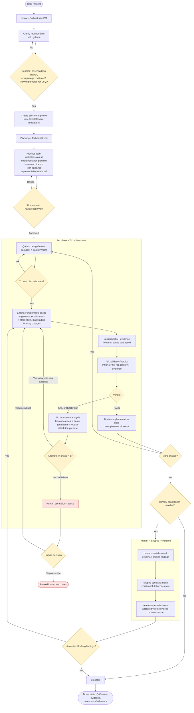

# Agentic Engineering Framework (Provider-Agnostic)

A general, file-based multi-agent framework for running end-to-end software engineering tasks: intake -> planning -> phased implementation -> QA -> review adjudication, with human-in-the-loop gates and auditable artifacts.

Designed to work across AI coding providers (OpenCode, Claude Code, Kiro, Cursor, Codex, Copilot, etc.) using a **single bootstrap prompt**: keep canonical behavior in-repo and let provider adapters/wiring vary.

## Quick start (single prompt)

1. Copy this framework into your target project/workspace (or keep as a control repo the agent can read).
2. Paste the bootstrap prompt from [`BOOTSTRAP.md`](BOOTSTRAP.md) into your AI environment (replace `<REPO_BOOTSTRAP_URL_OR_LOCAL_PATH>` with the local path or raw URL to `BOOTSTRAP.md`).
3. The agent should load framework context, check prerequisites, and start with `orchestrator-pm` intake.

Provider-specific setup notes: [`integrations/ai-providers.md`](integrations/ai-providers.md).

## Prerequisites

### Core
- Agent/environment can read repository files (and git recommended)
- Project toolchain for the target codebase (runtimes, package manager, build/test tools)

### UI QA (Playwright) — required for UI/browser QA flows
- Node.js + package manager (`npm`/`pnpm`/`yarn`)
- Playwright installed: `npx playwright --version` (or project dependency)
- Playwright browsers installed: `npx playwright install` (Linux/CI may need `npx playwright install --with-deps`)
- Ability to run the target app locally for QA (dev server/build URL)

If Playwright/browsers/app runtime are unavailable, UI automation must not be reported as passed; record gaps in QA verdicts and `implementation-state.md`.

## Model selection

- **User/provider choice:** select models based on your environment, budget, and task needs (no vendor/model IDs hardcoded by this framework).
- **Sensible defaults:** strong coding+reasoning model for planning/implementation/review; faster/cheaper model for simple edits; vision-capable model helpful for UI/screenshot-based QA and visual debugging.
- Prefer models with reliable tool use and sufficient context for multi-file work; per-role overrides are fine if supported.

## Where things live (canonical structure)

| Area | Location | Contents |
|---|---|---|
| **Core contracts/docs** | `core/` | Framework structure and artifact contracts (`core/structure.md`, `core/artifacts.md`) |
| **Agents** | `agents/` | Canonical agent prompts/specs (PM, TL, QA, specialists). OpenCode adapter symlinks at `.opencode/agents/`. |
| **Skills** | `skills/` | Canonical reusable skills (`skills/<skill-id>/SKILL.md`). OpenCode adapter symlinks at `.opencode/skills/`. |
| **Workflows** | `README.md` (this file) | Canonical end-to-end workflow (Mermaid diagram and notes below) |
| **Harness** | `harness/` | Execution, QA, review, evidence, retry/escalation rules (`harness/engineering-harness.md`) |
| **Templates** | `templates/` | PRD/plan/spec/state/QA/review artifact templates |
| **Tools (conventions)** | `tools/` | Tooling expectations and integration notes (not bundled runtimes) |
| **Adapters / Integrations** | `adapters/`, `integrations/` | Provider-specific setup and bootstrap notes |
| **Bootstrap** | `BOOTSTRAP.md` | Canonical single-prompt bootstrap |
| **OpenCode config** | `opencode.jsonc`, `.opencode/` | Example OpenCode project config and symlinked discovery paths |

> OpenCode compatibility: `.opencode/agents` and `.opencode/skills` symlink to canonical `agents/` and `skills/`.

## Inventory

### Agents (`agents/`)

#### Core roles
| Agent | Mode intent | Purpose |
|---|---|---|
| `orchestrator-pm` | primary | Intake, grill-me clarification, repo/branch+environment confirmation, PRD creation, handoff to technical lead |
| `technical-lead` | primary/subagent-capable | Technical assessment/planning, artifact ownership, phased orchestration, QA/review loops, escalation handling |
| `qa-agent` | subagent | Test plan/case design, test execution (incl. Playwright for UI), evidence capture, PASS/FAIL/BLOCKED verdicts |

#### Specialist roles by stack
Stacks included: `backend-node`, `frontend-node`, `backend-go`

| Role type | Agents | Purpose |
|---|---|---|
| **Engineer** | `engineer-specialist-backend-node`, `engineer-specialist-frontend-node`, `engineer-specialist-backend-go` | Implement assigned phase scope to spec, run local checks, provide evidence (frontend adds `data-testid` for QA) |
| **Hunter (review)** | `hunter-specialist-backend-node`, `hunter-specialist-frontend-node`, `hunter-specialist-backend-go` | Find defects/regressions/missing validation with evidence |
| **Skeptic (review)** | `skeptic-specialist-backend-node`, `skeptic-specialist-frontend-node`, `skeptic-specialist-backend-go` | Validate hunter findings as confirmed/refuted/inconclusive |
| **Referee (review)** | `referee-specialist-backend-node`, `referee-specialist-frontend-node`, `referee-specialist-backend-go` | Final adjudication, severity/priority, required actions |

### Skills (`skills/`)

#### Workflow, quality, and safety skills
| Skill | Purpose |
|---|---|
| `grill-me` | Requirements clarification/interrogation before PRD finalization |
| `brainstorming` | Clarify intent and design options before planning/implementation for ambiguous or high-impact work |
| `writing-plans` | Produce verifiable phased implementation plans with acceptance criteria and evidence expectations |
| `phase-execution` | Phased implementation harness: QA-first per phase, implementation, verdicts, retries, escalation |
| `executing-plans` | Execute approved plans inline task-by-task while preserving gates and evidence (no per-task subagents required) |
| `subagent-driven-development` | Delegate planned tasks to focused subagents with structured handoffs and verification gates |
| `dispatching-parallel-agents` | Partition independent work into parallel subagent tasks with clear scope and integration checks |
| `using-git-worktrees` | Set up/recognize isolated branch/worktree workspaces safely with baseline verification |
| `finishing-a-development-branch` | Close out work with verified evidence, finalized artifacts, and explicit integration decision |
| `architect` | Design interfaces/contracts/module boundaries before non-trivial implementation |
| `blast-radius` | Assess non-local impact of changes and prove key safety facts with runnable evidence |
| `qa-playwright` | QA planning/execution with evidence capture; Playwright-based UI validation and selector guidance |
| `verification-before-completion` | Require fresh evidence before claiming completion/pass/fix |
| `test-driven-development` | Strict red-green-refactor discipline for feature/behavior changes |
| `targeted-tdd` | Bugfix/regression-focused failing-check-first workflow when practical |
| `systematic-debugging` | Evidence-driven investigation and root-cause analysis before fixes |
| `fix-root-causes` | Root-cause-first debugging and reporting (not symptom patching) |
| `attack-the-premise` | On repeated same-gate failures, test the shared premise before another retry |
| `requesting-code-review` | Prepare focused, evidence-ready review requests with scope and verification context |
| `receiving-code-review` | Handle review feedback with technical verification before implementing changes |
| `review-adjudication` | Hunter -> skeptic -> referee code review workflow with evidence-backed decisions |
| `artifact-state` | Artifact discipline and implementation-state traceability (attempts, decisions, evidence) |
| `technical-writing` | Produce clear, structured, evidence-aware technical artifacts and reports |
| `benchmark-checklist` | Validate performance measurements/claims with reproducible evidence |
| `correct` | Convert repeated mistakes into durable prevention with proven guards |
| `boundary-discipline` | Validate at boundaries, keep internal logic trusted/typed, and preserve clean interfaces |
| `ponytail` | Smallest complete change discipline (minimal, verifiable, subtract-before-add) |
| `autonomy-with-gates` | Proceed on reversible in-scope work without blocking while honoring mandatory human gates |
| `writing-skills` | Create/revise canonical skills with clear triggers and framework-aligned guidance |

#### Stack skills
| Skill | Purpose |
|---|---|
| `backend-node` | Node.js/TypeScript backend implementation/testing/verification patterns aligned to framework gates/artifacts |
| `frontend-node` | Frontend (Node-tooling) implementation, accessibility, `data-testid`, and Playwright-friendly QA/testability patterns |
| `backend-go` | Go backend implementation/concurrency/error/testing/verification patterns aligned to framework gates/artifacts |
| `typescript-best-practices` | TypeScript correctness/modeling/boundary best practices for `.ts/.tsx` stack work |

#### Security and performance skills
| Skill | Purpose |
|---|---|
| `secure-backend-engineering` | Defensive REST/API hardening: HTTPS-only, endpoint access control, method/content-type/size handling, workflow state validation, rate limits, correct status codes, generic errors, security headers, CORS allowlist, secret hygiene |
| `api-security-review` | Defensive review pass over an existing API against the OWASP API Security Top 10 (endpoint inventory, BOLA/mass assignment, authn, resource consumption, misconfiguration, outbound safety) |
| `websocket-security` | Hardening and verifying real-time channels: `wss://`, RFC 6455 only, compression policy, origin allowlist (CSWSH), handshake auth, session/logout handling, per-message authorization, schema/size limits, replay nonces, rate/connection limits, backpressure, heartbeat, logging |
| `auth-authorization` | Identity proofing (passwords, MFA, throttling, generic errors, re-auth, sessions/tokens incl. JWT claim validation) and authorization decisions (deny-by-default, least privilege, per-request/per-object checks, ABAC/ReBAC, fail-secure, authz test matrix) |
| `input-validation-sanitization` | Boundary validation: allowlists, syntax+semantic checks, safe parsing, size/depth limits, Unicode normalization, anchored patterns, injection-resistant data access, context-aware encoding, file-upload checks, header/log hygiene |
| `backend-performance` | Diagnose and fix backend performance defects (N+1, missing indexes, unbounded results/pagination, caching, pooling, event-loop blocking, backpressure) with measured before/after evidence |

### Harness and core docs
| File | Purpose |
|---|---|
| `harness/engineering-harness.md` | Role harness rules, verification/evidence standards, retry limits, definition of done |
| `harness/session-lifecycle.md` | Initializer, session start/resume, checkpointing, and clean handoff for long-running runs |
| `core/artifacts.md` | Artifact naming, locations, and required contents/contracts |
| `core/context-engineering.md` | Context loading, progressive disclosure, compaction/checkpoints, and handoff guidance |
| `core/structure.md` | General repository/framework structure and adapter model |

### Templates (`templates/`)
- `prd-template.txt`
- `implementation-plan-template.md`
- `state-machine-template.md`
- `tech-spec-template.md`
- `implementation-state-template.md`
- `qa-test-plan-template.md`
- `qa-verdict-template.md`
- `review-hunter-template.md`
- `review-skeptic-template.md`
- `review-referee-template.md`
- `feature-list.template.json`
- `progress-log-template.md`
- `handoff-packet-template.md`

## Main workflow (canonical)

The canonical workflow lives in this README. Follow [`harness/engineering-harness.md`](harness/engineering-harness.md) and [`core/artifacts.md`](core/artifacts.md) for gates, evidence, and artifact contracts.

### Workflow notes
1. **Intake (Orchestrator/PM):** clarify vague request (`grill-me`), confirm repo/directory + base/working branch + environment/prereqs (incl. Playwright readiness for UI QA), create `<session-id>-prd.txt`.
2. **Planning (Technical Lead):** produce `tech-notes/<session-id>/{implementation-plan,state-machine,tech-spec,implementation-state}.md`, present for human review/revision, and pause for approval.
3. **Phased execution (TL-orchestrated):** per phase, QA designs/reviews tests first -> engineer implements to spec and passes local checks (frontend adds stable `data-testid`; apply relevant stack skills and `blast-radius` for risky changes) -> QA validates and issues evidence-backed verdict.
   - Phases that expose an API, authentication/authorization, untrusted input, a real-time channel, or hot-path data access additionally apply the security/performance skills (`secure-backend-engineering`, `api-security-review`, `auth-authorization`, `input-validation-sanitization`, `websocket-security`, `backend-performance`) and must carry matching QA cases.
4. **Retries & escalation:** on failure, apply root-cause analysis (`fix-root-causes`); if the same gate/pattern repeats, test the premise (`attack-the-premise`) before retry; **max 3 failed integration/QA attempts per phase** triggers mandatory human escalation/pause with evidence, hypotheses, and options.
5. **Review adjudication (optional/milestone):** hunter finds issues -> skeptic validates -> referee issues final actions; accepted blockers return to fix/QA loops.
6. **Closeout:** finalized implementation state, QA/review evidence, deployment/test notes, and remaining risks/follow-ups.
7. **Autonomy and evidence:** proceed on reversible in-scope work (`autonomy-with-gates`), but never claim completion without verification evidence; preserve gates and record tool/prereq gaps.

## Implementation of provided agentic-engineering sources (papers/resources)

Key principles from the provided Anthropic research/posts and `walkinglabs/learn-harness-engineering` are incorporated into this framework:
- **Effective agents & tool/context engineering:** clear role/tool contracts, structured artifacts, evidence over assertions, progressive disclosure/JIT context loading (`core/context-engineering.md`), and provider-agnostic bootstrap with explicit handoffs.
- **Multi-agent orchestration:** orchestrator/worker-style delegation with fresh-context handoffs, role specialization (PM/TL/engineer/QA/hunter/skeptic/referee), parallelization guidance (`dispatching-parallel-agents`), and file-based intermediate outputs/artifacts.
- **Long-running harnesses:** phased verifiable increments, QA-first gates, initializer/session lifecycle and clean handoffs (`harness/session-lifecycle.md`, `templates/progress-log-template.md`), machine-readable feature tracking (`templates/feature-list.template.json`), resumable state/evidence, and retry/escalation discipline.
- **Verification and reliability:** TDD/targeted checks, verification-before-completion, systematic debugging/root-cause and premise checks, blast-radius impact analysis, and evidence-backed review adjudication.

Some source ideas are represented as portable framework conventions (docs/skills/templates) rather than provider-specific automation; teams should adapt tool/runtime integrations per environment.

### Security skill sources (community library audit)

The canonical security/performance skills were adapted (not bulk-copied) from two sources: OWASP Cheat Sheet Series (canonical security knowledge) and the community library [mukul975/anthropic-cybersecurity-skills](https://github.com/mukul975/anthropic-cybersecurity-skills) (Apache-2.0, community project not affiliated with Anthropic PBC), which supplied the review/verification workflow shape.

| Upstream community skill | Adapted into |
|---|---|
| `testing-api-security-with-owasp-top-10` | `api-security-review`, `secure-backend-engineering` |
| `testing-api-for-broken-object-level-authorization` | `api-security-review`, `auth-authorization` |
| `testing-jwt-token-security` | `auth-authorization` |
| `testing-websocket-api-security` | `websocket-security` |

Deliberately **not** added to the default engineering harness: offensive/red-team/pentest, malware analysis, digital forensics/incident response, cloud/container/Kubernetes/OT/network/wireless hardening, phishing simulation, and compliance/purple-team skills. They are dual-use, require explicit authorization and specialist tooling, and do not belong in an implementation/QA/review loop. Security knowledge for mass assignment, CORS misconfiguration, SSRF, XSS/XXE, secrets handling, and dependency/supply-chain hygiene was folded into `api-security-review`, `input-validation-sanitization`, and `secure-backend-engineering` with OWASP grounding rather than duplicated as separate skills.

## Usage notes

- **OpenCode:** use `opencode.jsonc` and `.opencode/` symlinks (see `adapters/opencode.md`).
- **Other providers:** follow `integrations/ai-providers.md`; if subagents are unavailable, run roles sequentially but preserve artifacts, gates, and evidence.
- **Canonical source of truth:** edit `agents/` and `skills/`; adapters should reference/mirror them.
- **Session outputs:** generate PRD/tech-notes/QA/review artifacts per session using `templates/` and `core/artifacts.md`.
- **Stack skills:** specialists should apply the matching stack skill (`backend-node`, `frontend-node`, `backend-go`) and `typescript-best-practices` for TS/TSX work.
- **Security/performance skills:** apply `secure-backend-engineering` plus `api-security-review`, `auth-authorization`, `input-validation-sanitization`, `websocket-security`, and `backend-performance` as the touched surface requires; unverified controls are reported as gaps, never assumed secure.

## Extending

- Add stacks by creating `engineer/hunter/skeptic/referee-specialist-<stack>` agents and a matching `skills/<stack>/SKILL.md`.
- Add skills for project-specific tooling/deployment/architecture while keeping core gates intact.
- Add tool wrappers/scripts in `tools/` and provider mappings in `adapters/`/`integrations/`.
- Tune thresholds/evidence requirements in `harness/engineering-harness.md` to match project risk.
